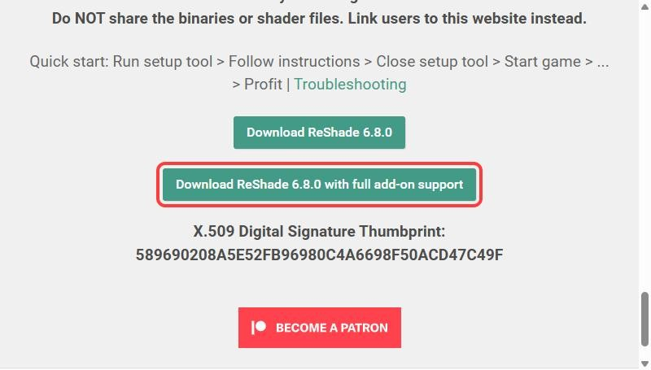
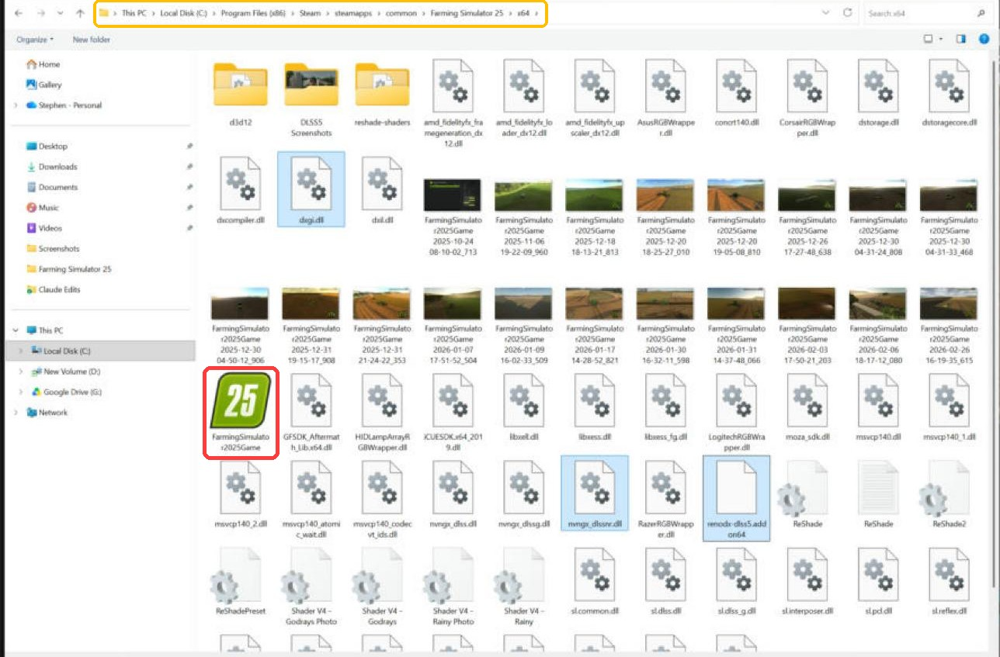
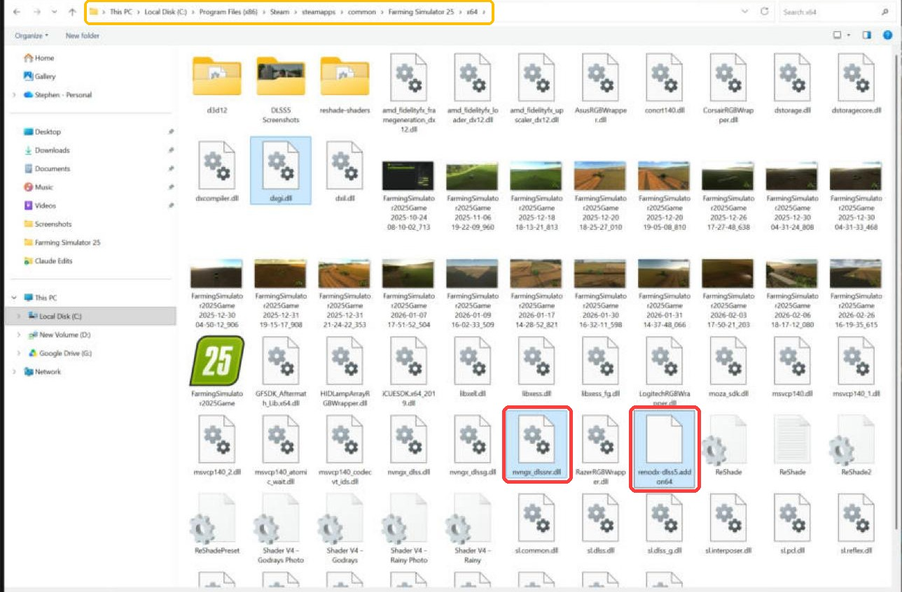
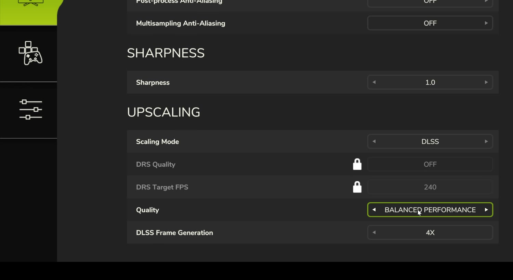
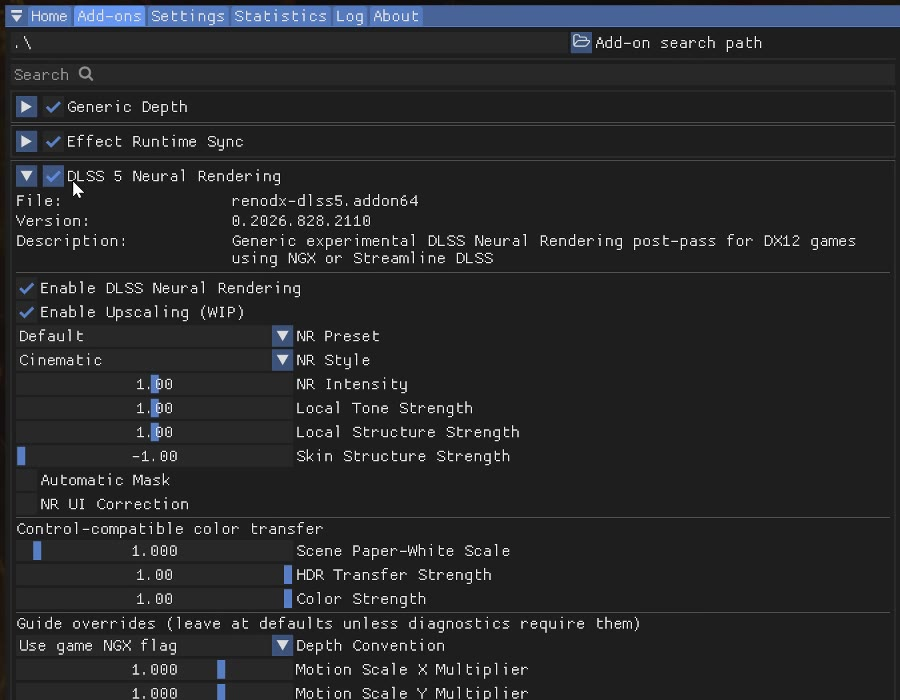
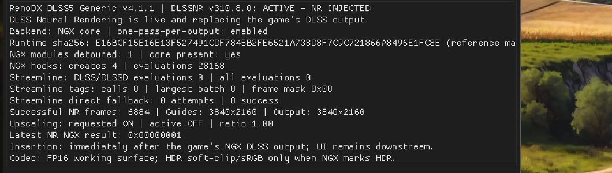

# DLSS 5 in Farming Simulator 25: Install Guide

A step-by-step guide to running **DLSS 5 Neural Rendering** in **Farming Simulator 25** with **ReShade** and the **RenoDX DLSS 5 add-on**.

📺 **Video tutorial:** _[add your YouTube link here]_
🔴 **Live streams:** [YouTube](https://www.youtube.com/@ScubaDoobie/live) · [Kick](https://kick.com/scubadoobie) · [Twitch](https://www.twitch.tv/scubadoobie)

> [!WARNING]
> This is an **unofficial, experimental community mod**. It is not made, supported or endorsed by NVIDIA or GIANTS Software. DLSS 5 improves **image quality** but **lowers FPS**. Back up your game folder and use it at your own risk.
>
> **This repository does not host any game, NVIDIA or ReShade files.** It only contains instructions and links to the official sources.

---

## Where do I get the files?

| File | Where it comes from | Link |
|---|---|---|
| **ReShade 6.8 with full add-on support** | The official ReShade website by crosire | **[reshade.me → Download](https://reshade.me/#download)** |
| **`renodx-dlss5.addon64`** (DLSS 5 add-on) | The RenoDX project. The DLSS 5 add-on is an experimental community build. It is **not** in RenoDX's normal GitHub Releases yet; it's shared through the official RenoDX Discord. | **[RenoDX Discord](https://discord.gg/renodx)** · [RenoDX on GitHub](https://github.com/clshortfuse/renodx) |
| **`nvngx_dlssnr.dll`** (DLSS 5 runtime) | NVIDIA. It hasn't been publicly released by NVIDIA yet; the RenoDX community provides it alongside the add-on. | **[RenoDX Discord](https://discord.gg/renodx)** |

> [!NOTE]
> **This repo doesn't host any of these files.** Always download them from the sources above, never from random re-uploads, and scan anything you download.

---

## Contents

- [Where do I get the files?](#where-do-i-get-the-files)
- [What you need](#what-you-need)
- [Step 1: Install ReShade (add-on version)](#step-1-install-reshade-add-on-version)
- [Step 2: Add the DLSS 5 files](#step-2-add-the-dlss-5-files)
- [Step 3: In-game graphics settings](#step-3-in-game-graphics-settings)
- [Step 4: Enable DLSS 5 in ReShade](#step-4-enable-dlss-5-in-reshade)
- [Check that it's working](#check-that-its-working)
- [Troubleshooting](#troubleshooting)
- [Uninstall](#uninstall)
- [Credits](#credits)

---

## What you need

| Item | Notes |
|---|---|
| **NVIDIA GeForce RTX 50 or RTX 40 GPU** | RTX 40 cards need the build made for 40-series (Ada) cards. RTX 20/30 are experimental and very slow. |
| **Latest NVIDIA driver** | Update with the NVIDIA app before you start. |
| **Farming Simulator 25 on Steam** | Default folder: `C:\Program Files (x86)\Steam\steamapps\common\Farming Simulator 25\x64` |
| **ReShade 6.8 with full add-on support** | From the official site: **[reshade.me](https://reshade.me/#download)**. Get the *"with full add-on support"* download, not the standard one. |
| **RenoDX DLSS 5 add-on** (`renodx-dlss5.addon64`) + **DLSS 5 runtime** (`nvngx_dlssnr.dll`) | Both come from the RenoDX community. See [Where do I get the files?](#where-do-i-get-the-files) |

> [!TIP]
> Not sure where your game is installed? In Steam, right-click **Farming Simulator 25** → **Manage** → **Browse local files**, then open the **x64** folder.

---

## Step 1: Install ReShade (add-on version)

1. Go to **[reshade.me](https://reshade.me/#download)** and click **Download ReShade 6.8.0 with full add-on support**.

   

2. Run the installer and click **Browse**.
3. Go to your Farming Simulator 25 **x64** folder and select **`FarmingSimulator2025Game.exe`**.

   

4. Choose **DirectX 10/11/12**.
5. Skip the shader packages. DLSS 5 doesn't need them.

> [!IMPORTANT]
> The standard ReShade download **can't load add-ons**. Using it is the most common reason this setup fails.

---

## Step 2: Add the DLSS 5 files

Download the DLSS 5 add-on package from the **[RenoDX Discord](https://discord.gg/renodx)** (see [Where do I get the files?](#where-do-i-get-the-files)). Make sure you get the build for your GPU (RTX 50, or the RTX 40/Ada build).

Copy these **two files** into the same **x64** folder:

- `nvngx_dlssnr.dll`
- `renodx-dlss5.addon64`

They go right next to `FarmingSimulator2025Game.exe` and ReShade's `dxgi.dll`.

> [!CAUTION]
> **Don't replace** any of the game's own NVIDIA files (`nvngx_dlss.dll`, `nvngx_dlssg.dll`, `sl.*.dll`). Only **add** the two files above.

---

## Step 3: In-game graphics settings

1. Launch Farming Simulator 25 → **Options** → **Advanced Graphics Settings** → **Upscaling**.
2. Set **Scaling Mode** to **DLSS**.
3. Set **Quality** to one of these:
   - **DLAA**: most reliable, best image quality
   - **Balanced / Performance**: more FPS (shown below)
4. **Don't use DLSS Quality.** DLSS 5 won't activate in that mode.

---

## Step 4: Enable DLSS 5 in ReShade

1. Load into your save.
2. Press **Home** to open ReShade.
3. Open the **Add-ons** tab and expand **DLSS 5 Neural Rendering**.
4. Make sure **Enable DLSS Neural Rendering** is ticked. **Enable Upscaling (WIP)** can stay on.
5. Press **Home** again to close the menu.

---

## Check that it's working

At the bottom of the DLSS 5 Neural Rendering section, the status line should say **ACTIVE – NR INJECTED**, and **Successful NR frames** should keep counting up.

---

## Troubleshooting

| Problem | Fix |
|---|---|
| No **Add-ons** tab in ReShade, or DLSS 5 isn't listed | You installed the standard ReShade. Reinstall using **"with full add-on support"**. |
| Status says **STANDBY** or **FAILED** | Change the in-game DLSS mode to **DLAA** (or Balanced/Performance). DLSS Quality doesn't work. |
| ReShade doesn't open with **Home** | Check that ReShade was installed to `FarmingSimulator2025Game.exe` in the **x64** folder with **DirectX 10/11/12**. |
| Game crashes on launch | Make sure you didn't overwrite any of the game's own NVIDIA files. If you did, verify the game files in Steam and reinstall. |
| Low FPS | Expected: DLSS 5 trades FPS for image quality. Try Balanced/Performance mode, or toggle neural rendering with **F6**. |
| Stopped working after a game or driver update | Reinstall ReShade and recopy the two files, or check the RenoDX project for an updated build. |

---

## Uninstall

Delete these from the **x64** folder:

- `dxgi.dll`
- `ReShade.ini`
- the `reshade-shaders` folder
- `nvngx_dlssnr.dll`
- `renodx-dlss5.addon64`

Then, in Steam, right-click the game → **Properties** → **Installed Files** → **Verify integrity of game files**.

---

## Credits

- **ReShade** by crosire: [reshade.me](https://reshade.me)
- **RenoDX** by clshortfuse and contributors: [github.com/clshortfuse/renodx](https://github.com/clshortfuse/renodx)
- **Farming Simulator 25** by GIANTS Software
- **DLSS** is a trademark of NVIDIA Corporation

Guide by **[@ScubaDoobie](https://www.youtube.com/@ScubaDoobie)**. If it helped, ⭐ star the repo and drop your GPU and FPS in the video comments!

The guide text and screenshots are shared under [CC BY 4.0](LICENSE). All third-party software belongs to its respective owners.
